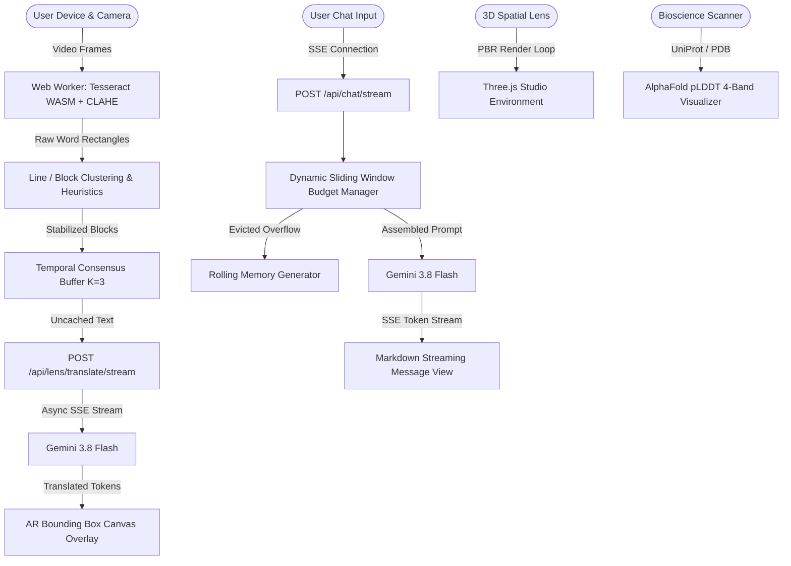

# Next Chat AI & Smart Lens: Streaming Vision-Language & Edge OCR System

A high-performance full-stack system uniting on-device WASM OCR, Server-Sent Events (SSE) token streaming, sliding-window context memory, and 3D spatial vision simulation.



---

## How It Works

### 1. Server-Sent Events (SSE) Flow
- The client dispatches a `POST /api/chat/stream` or `POST /api/lens/translate/stream` request with a JSON payload and `AbortController.signal`.
- The server sets `Content-Type: text/event-stream`, `Cache-Control: no-cache, no-transform`, and `X-Accel-Buffering: no` (to bypass upstream reverse proxy buffering like Nginx/Caddy).
- Streaming events are emitted with typed event envelopes:
  - `event: meta` — token counts, available context budget, eviction stats.
  - `event: token` — individual generated LLM tokens flushed immediately.
  - `event: ping` — 15s keepalive heartbeat preventing connection timeout.
  - `event: grounding` — Google Search grounding citations with outbound links.
  - `event: done` — final stream completion notice.
- Client disconnects trigger upstream request aborts via `req.on('close')`.

### 2. Sliding-Window Token Budget Eviction Logic
- Traditional chatbots evict by message count, which fails when users input long logs or code blocks.
- Our context manager computes:
  $$\text{Available Budget} = \text{Max Budget} - \text{Pinned System Tokens} - \text{Reserved Response Tokens}$$
- The system prompt is permanently pinned.
- The most recent $N$ turns are held verbatim.
- Older turns are evaluated in reverse chronological order. When accumulated tokens exceed the available budget, older turns are evicted and folded into a rolling factual summary generated by Gemini.
- The compact summary is re-injected as a high-priority memory block without exceeding its dedicated token cap.

### 3. Smart Lens Pipeline Stages
1. **Frame Capture & Sampling:** Frames from the device camera are sampled via `requestAnimationFrame` with busy-state skipping (drops frames if the worker is still processing).
2. **Worker Preprocessing (Non-blocking UI):** Canvas-level Grayscale, Contrast Normalization (min-max stretch / CLAHE), Adaptive Thresholding, and Light Denoising run inside a dedicated Web Worker running Tesseract.js WASM.
3. **Bounding-Box Post-Processing:**
   - Confidence thresholding (filters noise below 40%).
   - Intersection over Union (IoU) Non-Maximum Suppression (NMS) merges duplicate/overlapping boxes.
   - Vertical overlap line grouping and line-spacing block clustering establish coherent reading order for multi-column documents.
4. **Linguistic Cleaning:** Heuristic regexes fix optical character confusion in context (`0` $\leftrightarrow$ `O`, `1` $\leftrightarrow$ `l`/`I`, `rn` $\leftrightarrow$ `m`) and discard implausible non-alphanumeric junk.
5. **Temporal Consensus Stabilization:** Multi-frame buffer enforces cross-frame Levenshtein consensus ($K=3$ frames, similarity $\ge 0.82$) before triggering translation.
6. **Cached Translation Streaming:** Translations are hashed using SHA-256; cached blocks return instantly, while uncached blocks stream back via SSE from `gemini-3.8-flash`.
7. **Lens Calibration & Sensor Control:** Manual exposure compensation ($-2.0$ to $+2.0$ EV), white balance color temperature ($2500$K to $8000$K), and contrast gain sliders. Adjusts hardware track constraints via `applyConstraints()` where supported, and executes pixel-level luminance/temperature shifts on the canvas before dispatching to Tesseract WASM.
8. **VLM Fallback:** Regions that fail confidence thresholds can be cropped and submitted to Gemini Vision for a second-opinion read.

---

## Tech Stack

- **Frontend:** React 19, TypeScript, Vite, Tailwind CSS v4, Lucide Icons, Three.js (PBR Studio, ACESFilmicToneMapping, RoomEnvironment).
- **Backend (Python 3.11):** FastAPI, Uvicorn, Pydantic v2, `google-genai` SDK, `sse-starlette`, `pytest`.
- **Backend (Node.js/Express):** Fullstack Express server with Vite middleware handling all `/api/*` SSE endpoints and static production assets.
- **On-Device OCR:** Tesseract.js (WASM) in a Web Worker.
- **Database & Auth:** Firebase Auth (Google Sign-In) and Cloud Firestore with Attribute-Based Access Control (ABAC) Zero-Trust security rules.

---

## Environment Variables

Configure these variables via `.env` (or AI Studio Secrets):

```env
# Google Gemini API Key
GEMINI_API_KEY="your-gemini-api-key"

# Port (Defaults to 3000 in AI Studio / 8000 for standalone Python)
PORT=3000
HOST=0.0.0.0
```

---

## Quickstart & Run Commands

### 1. Web Application (Full-Stack Dev Server)
```bash
# Install dependencies
npm install

# Start development server on port 3000
npm run dev

# Run TypeScript compilation check
npm run lint

# Build production bundle
npm run build
```

### 2. Python FastAPI Backend (Alternative Standalone Mode)
```bash
# Setup virtual environment
python3.11 -m venv venv
source venv/bin/activate

# Install Python requirements
pip install -r requirements.txt

# Run pytest unit test suite
pytest backend/tests -v

# Run evaluation benchmark harness
python eval/run_eval.py

# Launch FastAPI server
uvicorn backend.main:app --host 0.0.0.0 --port 8000 --reload
```
